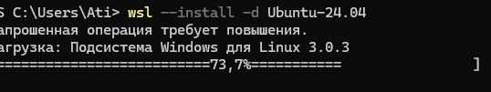

# Отчет по развертыванию окружения в WSL (Windows Subsystem for Linux)

**Выполнил:** Мурина В.Е. (пользователь Linux: `MurzinaVE`)  
**ОС хоста:** Windows  
**ОС в WSL:** Ubuntu 24.04  
**Дата и время выполнения:** 22 октября 2026 года  

---

## 1. Установка WSL и дистрибутива Ubuntu
Для начала работы была выполнена установка подсистемы Windows для Linux (WSL) и дистрибутива Ubuntu 24.04 через PowerShell от имени администратора. Также был установлен дополнительный компонент VirtualMachinePlatform.

**Команда:**
```bash
wsl --install -d Ubuntu-24.04
```

