# Отчет по развертыванию окружения в WSL (Windows Subsystem for Linux)

**Выполнил:** Мурина В.Е. (пользователь Linux: `MurzinaVE`)  
**ОС хоста:** Windows  
**ОС в WSL:** Ubuntu 24.04  
**Дата и время выполнения:** 22 октября 2026 года  

## Установка WSL и дистрибутива Ubuntu
Для начала работы была выполнена установка подсистемы Windows для Linux (WSL) и дистрибутива Ubuntu 24.04 через PowerShell от имени администратора. Также был установлен дополнительный компонент VirtualMachinePlatform.

**Команда:**
```bash
wsl --install -d Ubuntu-24.04
```
                                                                                                       
## Начало установки WSL и Ubuntu 24.04
Запущена установка подсистемы Windows для Linux (WSL) и дистрибутива Ubuntu 24.04 через PowerShell от имени администратора. На скриншоте виден процесс загрузки компонента WSL 3.0.3 (73.7%).
Команда:
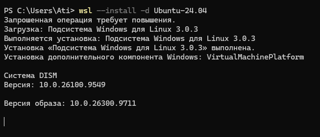
 ## Проверка статуса WSL после установки
После установки проверен список дистрибутивов командой wsl --list --verbose. Ubuntu отображается как установленный дистрибутив версии 2. Выполнен вход в систему и проверено имя пользователя.
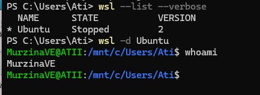

 ## Завершение установки WSL и компонентов
Установка подсистемы Windows для Linux 3.0.3 завершена успешно. Также установлен дополнительный компонент Windows: VirtualMachinePlatform. Отображены версии системы DISM (10.0.26100.9549) и образа (10.0.26300.9711).
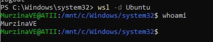

## Обновление системных пакетов Ubuntu
Выполнено обновление списков пакетов и самих пакетов в системе Ubuntu. Загружено 32.1 MB данных за 9 секунд. Система сообщила, что 131 пакет может быть обновлен.

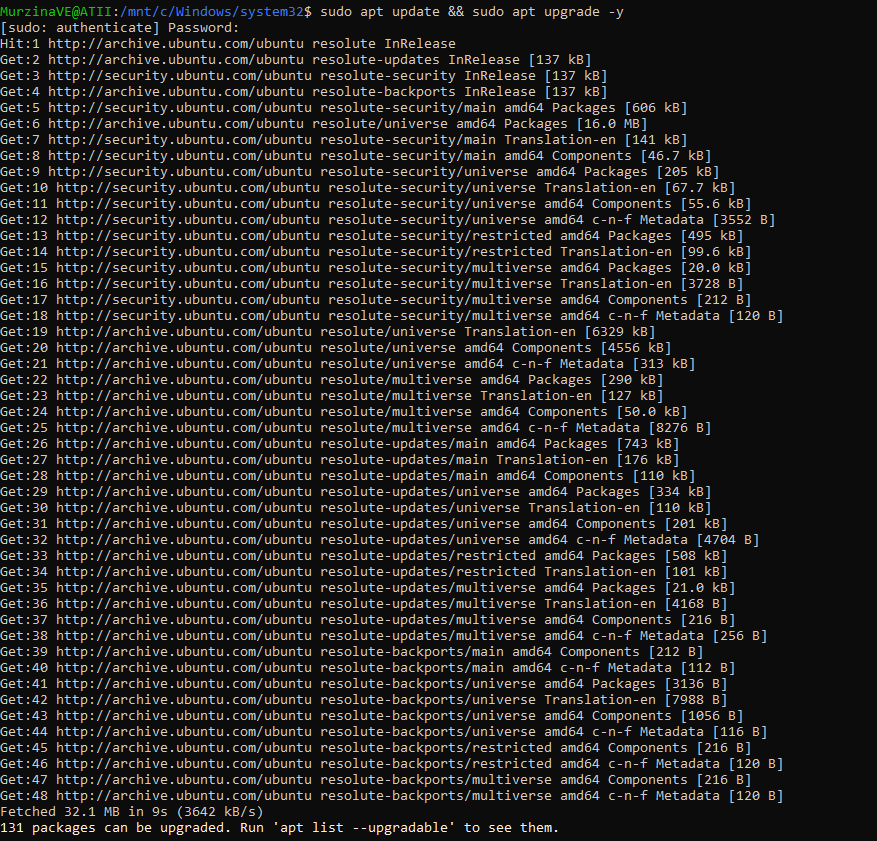

##  Установка компиляторов C/C++ (пакет build-essential)

Установлен пакет `build-essential`, который включает компиляторы `gcc`, `g++`, утилиту `make` и необходимые библиотеки для разработки на C/C++.

**Команда:**

```bash
sudo apt install build-essential -y
```
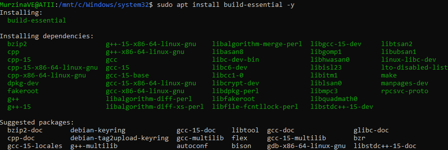

## Установка интерпретатора Python и менеджера пакетов pip
Установлен интерпретатор Python 3 (версия 3.14.3 уже была установлена) и менеджер пакетов python3-pip с необходимыми зависимостями.

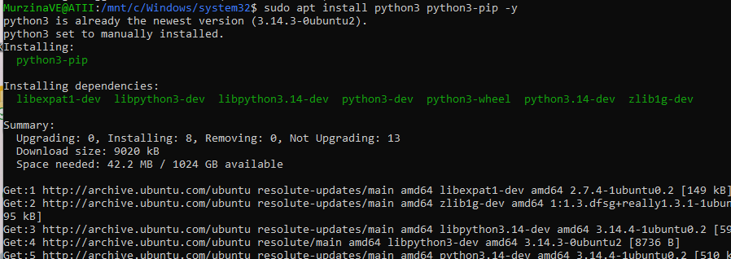

## Установка СУБД PostgreSQL
Установлена реляционная СУБД PostgreSQL версии 18 вместе с дополнительными модулями (postgresql-contrib). Система автоматически выбрала postgresql-18.
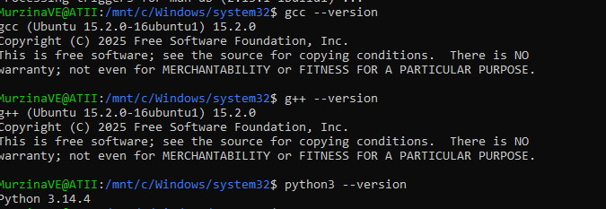

## Проверка версии клиента PostgreSQL
Проверена версия клиента PostgreSQL. Установлена версия 18.6 для Ubuntu 26.04.
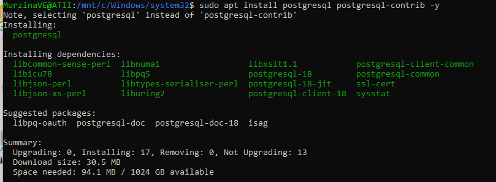

## Проверка версий компиляторов и интерпретатора
Проверены версии всех установленных инструментов разработки: компиляторов GCC/G++ и интерпретатора Python.

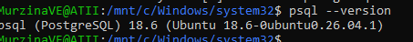

## Вход в консоль PostgreSQL

Выполнен вход в интерактивную консоль PostgreSQL от имени системного пользователя `postgres`. Проверена работоспособность СУБД — отображена версия psql 18.6. После проверки выполнена команда `\q` для выхода из консоли.

**Команда:**

```bash
sudo -u postgres psql
```
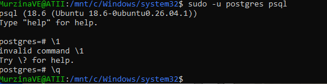

## Установка системы контроля версий Git
Проверена установка Git для работы с репозиториями. Git уже был установлен в системе.
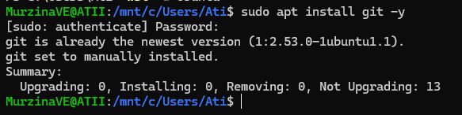
## Настройка Git и инициализация репозитория
Выполнена первоначальная настройка Git: указано имя пользователя и адрес электронной почты. Создана папка wsl-env-setup для хранения отчёта, выполнен переход в неё и инициализирован новый Git-репозиторий.
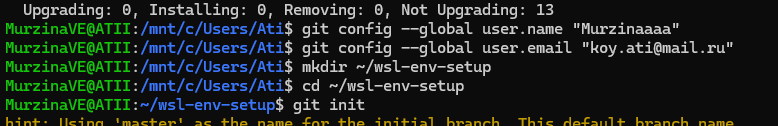

## Итог

В ходе выполнения задания было успешно развернуто и настроено рабочее окружение в подсистеме WSL на базе Ubuntu 24.04. Установлены и полностью проверены все требуемые инструменты: компиляторы C/C++, интерпретатор Python, СУБД PostgreSQL и система контроля версий Git, после чего отчет загружен в публичный Git-репозиторий.
